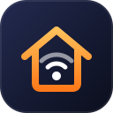
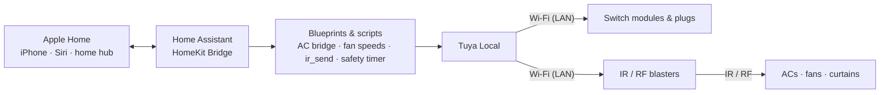

  

<h1 align="center">apple-home-india</h1>

  <b>Make affordable Indian smart devices work natively in Apple Home, entirely over your home network.</b>

      

Tuya switch modules, plugs and IR blasters are cheap and sold everywhere in India, but they don't work with Apple Home, and most Indian ACs and fans are infrared-only. This project uses Home Assistant on a Raspberry Pi to turn all of them into native Apple Home accessories: lights, thermostats, fans, curtains and geysers, controlled from the Home app and Siri, **with no cloud and no internet needed**.

<h3 align="center">▶ Watch the 48-second demo</h3>

https://github.com/user-attachments/assets/e45b489c-16ab-48d8-aee3-de4f91f7469c

  Every command in the video runs over the local network. <a href="docs/media/apple-home-india-demo.mp4">Download the video</a>

> **New here? Start with the [setup guide](docs/04-setup-guide.md).**

## What it does

| In the home | In Apple Home |
|---|---|
| Wi-Fi switch module behind an existing modular switch | Light |
| Smart plug on a geyser | Switch with an automatic cut-off that survives power cuts and restarts |
| Any IR-only split AC, **whether or not Tuya recognises the brand** | Thermostat: cool, off, 16–30 °C |
| IR ceiling fan | Fan with power and 5 speeds |
| RF (433 MHz) curtain motor | Curtain with open, close and stop |

**Why it matters**

- **Cost:** ₹28,957 in hardware for a whole 3BHK (21 light circuits, 2 lamps, 2 geysers, 5 ACs, 4 fans, 2 curtains). Commercial retrofits for the same appliances are estimated at ₹1.4–2.8 lakh, and turnkey installations at about ₹5 lakh. See the [bill of materials](docs/03-bill-of-materials.md).
- **No rewiring:** switch modules fit behind existing switches; ACs, fans and curtains are untouched.
- **Any AC:** commands are learned from the AC's own remote, so unrecognised brands and models work.
- **Fully local:** every command goes over your Wi-Fi via [Tuya Local](https://github.com/make-all/tuya-local), about twice as fast as the cloud, and keeps working when the internet is down.
- **Safe:** geysers switch themselves off on schedule, even across restarts and power cuts.

## How it works

IR and RF appliances can't report their state, so Home Assistant remembers it, and every AC command is a complete state (mode + temperature), so a missed command fixes itself on the next one. Details: [architecture](docs/02-architecture.md) and [IR/RF design](docs/05-ir-design.md).

## What's in this repository

| Path | What it is |
|---|---|
| [`blueprints/automation/apple-home-india/ir_ac_bridge.yaml`](blueprints/automation/apple-home-india/ir_ac_bridge.yaml) | Turns an IR-only AC into an Apple Home thermostat using codes learned from its remote |
| [`blueprints/automation/apple-home-india/appliance_safety_timer.yaml`](blueprints/automation/apple-home-india/appliance_safety_timer.yaml) | Restart-safe automatic cut-off for geysers and other appliances |
| [`packages/examples/`](packages/examples/) | Copy-and-rename examples: local-first IR/RF sender (`ir_send`), IR AC, IR fan with 5 speeds, RF curtain, shared fan script, geyser timer |
| [`docs/`](docs/README.md) | Setup guide, design notes, bill of materials, case study, history |
| [`tools/`](tools/) | Privacy scan and the config-validation scripts used by CI |

## Documentation

| Doc | |
|---|---|
| [01 · The problem](docs/01-problem.md) | What this solves, and what it doesn't |
| [02 · Architecture](docs/02-architecture.md) | The pieces and how they connect |
| [03 · Bill of materials](docs/03-bill-of-materials.md) | Real costs, and the retrofit comparison |
| [04 · Setup guide](docs/04-setup-guide.md) | **Build it:** from a blank Raspberry Pi to Apple Home, fully local |
| [05 · IR and RF design](docs/05-ir-design.md) | How one-way appliances become reliable accessories |
| [06 · Case study: restarts](docs/06-crash-case-study.md) | Debugging Home Assistant restarting itself |
| [07 · Moving a cloud setup to local](docs/07-local-control.md) | For existing Tuya cloud users: migrate without starting over |
| [History](docs/history.md) | How the project grew since August 2025, dated from Home Assistant's own records |

## Requirements

- Raspberry Pi 4 or 5 with Home Assistant OS (microSD card, power supply, Ethernet for setup)
- Tuya-based Wi-Fi switch modules, plugs and IR/RF blasters
- iPhone or iPad with the Home app; an Apple TV or HomePod as a home hub is recommended
- A Smart Life account, used once to fetch each device's local key. **No Tuya developer account needed.**

The full checklist is in [setup guide, section 0](docs/04-setup-guide.md#0-before-you-start).

## Limitations

- **IR and RF are one-way.** Appliances can't report their real state; using the physical remote makes Home Assistant's remembered state drift until the next command from Apple Home.
- **RF learning depends on the blaster.** Not every IR + RF blaster supports learning RF over the local network; such curtains can fall back to a Smart Life scene through the cloud.

## Validation

Every push runs three checks ([`.github/workflows/validate.yml`](.github/workflows/validate.yml)):

1. **Privacy scan:** blocks email addresses, private IPs, MAC addresses, tokens, device keys and personal words from being committed.
2. **YAML lint** of every blueprint, example and workflow.
3. **Home Assistant config check:** loads every blueprint and example into the official Home Assistant image (2026.10.1) and fails on any error.

## Credits

- **[Tuya Local](https://github.com/make-all/tuya-local)** by make-all and contributors: local control of Tuya devices, including learning and sending IR/RF codes. The local half of this project is built on it.
- **[Home Assistant](https://www.home-assistant.io)** and its [HomeKit Bridge](https://www.home-assistant.io/integrations/homekit/).
- **[HACS](https://hacs.xyz)**, the Home Assistant Community Store.
- **[tinytuya](https://github.com/jasonacox/tinytuya)** by Jason Cox and contributors: used to export and convert codes learned in the Tuya cloud ([doc 07](docs/07-local-control.md)).

## About the author

**Sumukh Nayak** is a Grade 12 student in Bengaluru, India, with interests in web development and AI/ML. He designed, built and maintains this system in his family home, where it has run every day since August 2025. It started from a simple frustration: Apple Home is a great place to control a home, but almost nothing sold in India works with it, and the retrofit alternatives cost lakhs. This repository is the result, written up so that anyone can do the same for a fraction of the price.

## License

Released under the [MIT License](LICENSE). © 2026 Sumukh Nayak.
