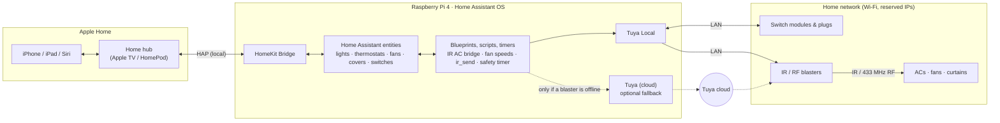

# Architecture

## Overview

## Layers

### 1. Apple Home

Apple Home talks to Home Assistant's **HomeKit Bridge** over the local network (HomeKit Accessory Protocol). Every Home Assistant entity the bridge exposes becomes a native tile. A **home hub** (Apple TV or HomePod) is needed for Apple Home automations and for control away from home.

### 2. Home Assistant entities: what Apple Home sees

| Apple Home tile | Home Assistant entity | Built from |
|---|---|---|
| Light | `light.*` | A Tuya Local switch, converted with **Change device type of a switch** |
| Geyser switch | `switch.*` | A Tuya Local smart plug |
| AC thermostat | `climate.*` | `generic_thermostat`, with a dummy heater switch and a virtual temperature sensor (see [05-ir-design.md](05-ir-design.md)) |
| Ceiling fan | `fan.*` | A template fan backed by helper entities that remember power and speed |
| Curtain | `cover.*` | A template cover backed by a helper that remembers open/closed |

Helpers that exist only to make this work (dummy heaters, IR blaster remotes) are **excluded** from the bridge, so Apple Home shows only real devices.

### 3. Logic

| Piece | Job |
|---|---|
| `ir_ac_bridge` blueprint | Turns thermostat changes (mode, setpoint) into the right learned AC command |
| `fans.yaml` script | Turns fan percentage into one of 5 speed commands, queued so fast slider drags apply in order |
| `ir_send` script | Sends every IR/RF command: locally through the blaster if it's reachable, otherwise through a Smart Life scene of the same name |
| `appliance_safety_timer` blueprint | Restart-safe auto-off for geysers |

### 4. Device integrations

- **[Tuya Local](https://github.com/make-all/tuya-local)** controls switch modules, plugs and IR/RF blasters directly over the LAN, using each device's local key.
- **Tuya (cloud)** is optional: it only provides Smart Life scenes as a fallback when a blaster is unreachable.
- Other locally controlled devices (WiZ bulbs, Matter devices) plug into the same layer unchanged.

### 5. The home network

Every device has a **reserved IP address**, because Tuya Local finds devices by IP. The Pi uses Ethernet and a UPS.

## Design principles

| Principle | How it shows up |
|---|---|
| **Local first, cloud as fallback** | Commands go over the LAN; a cloud scene is used only when a blaster is offline. Works without internet. |
| **Remember what can't be read** | IR and RF appliances can't report state, so helpers remember power, speed, setpoint and curtain position. |
| **Full-state commands** | Each AC command carries a complete state (mode + temperature), so a missed or repeated command can't leave the AC in a mixed state. |
| **Order matters** | Scripts that send commands run in *queued* mode, so commands are applied in the order they were given. |
| **Restart-safe** | Timers are restorable and re-checked after every start-up; geyser plugs also carry their own hardware countdown. |
| **Stable entity IDs** | Devices can be swapped (cloud → local) without breaking automations or Apple Home. |
| **No personal data in the repo** | A privacy scan blocks keys, IPs, MAC addresses and names on every change. |

## Resource use

On a Raspberry Pi 4 (4 GB) running Home Assistant OS, the full system (about 45 Apple Home accessories plus several other integrations) uses roughly 600 MB of memory at steady state. See [06-crash-case-study.md](06-crash-case-study.md) for what happened when one integration didn't.

## References

- Home Assistant: [HomeKit Bridge](https://www.home-assistant.io/integrations/homekit/) · [Generic Thermostat](https://www.home-assistant.io/integrations/generic_thermostat/) · [Template (fans, covers, switches, sensors)](https://www.home-assistant.io/integrations/template/) · [Change device type of a switch](https://www.home-assistant.io/integrations/switch_as_x/) · [Scripts](https://www.home-assistant.io/integrations/script/) · [Blueprints](https://www.home-assistant.io/docs/blueprint/) · [Timer](https://www.home-assistant.io/integrations/timer/)
- [Tuya Local](https://github.com/make-all/tuya-local) by make-all and contributors
- Apple: [Set up a home hub](https://support.apple.com/en-in/102557)
- Diagram drawn with [Mermaid](https://mermaid.js.org), rendered natively by GitHub
